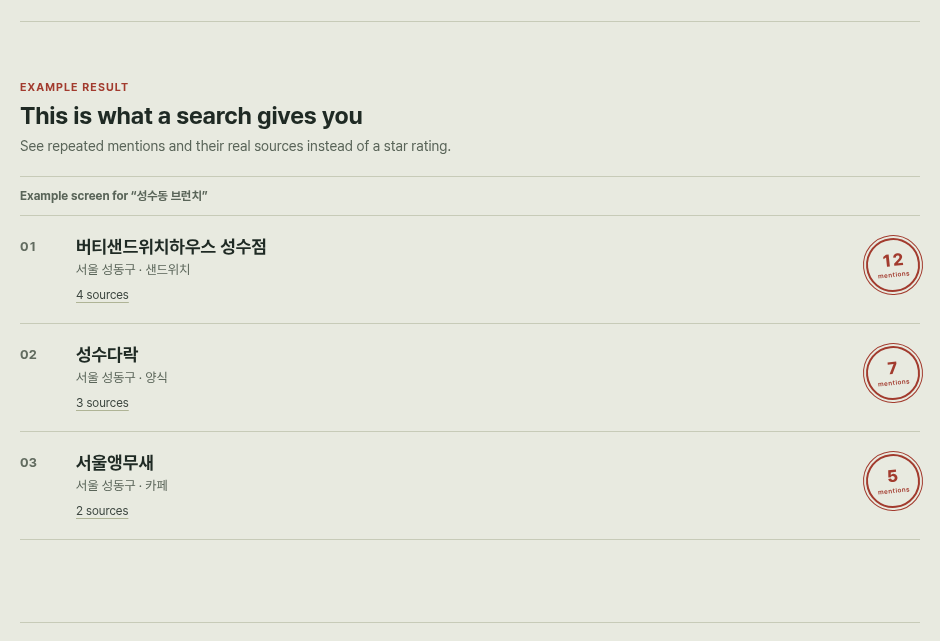

# Placepick

Find the places mentioned in Naver blog search results without opening each post. Placepick uses Gemini to pull business names out of result titles and snippets, then matches them to Kakao Map places. Results are ranked by mention count, with links to source posts and maps.



<sub>The example result shown on the demo's landing page.</sub>

Mention counts come from search results. They do not confirm visits or independent authors.

## Getting started

You need Docker with Docker Compose and API keys for Gemini, Kakao Local REST, and Naver Search (blog and local). Run from the repository root.

```bash
cp .env.example .env
```

Replace the four placeholders in `.env` with your keys: `GEMINI_API_KEY`, `KAKAO_REST_API_KEY`, `NAVER_CLIENT_ID`, and `NAVER_CLIENT_SECRET`.

```bash
docker compose up -d --build
```

Open <http://127.0.0.1:8001> and search for something like `성수동 브런치`.

## Learn more

- [Extraction, matching, and collection decisions](docs/decisions.md) (Korean)
- [Visual design spec](docs/design-spec.md) (Korean)
- [Security policy](SECURITY.md)

## License

[MIT](LICENSE) © 2026 jwhitekim
